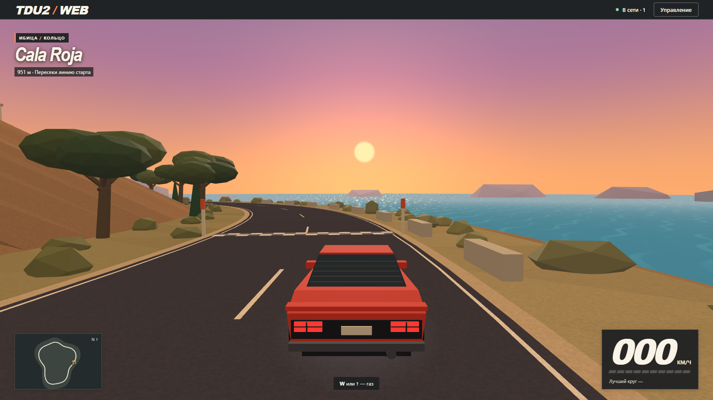

# TDU2 Web

Сетевая браузерная игра по мотивам Test Drive Unlimited 2 и эксперимент по переносу PC-версии в браузер. Сегодня можно проехать **Cala Roja** — авторское прибрежное кольцо длиной 951 м, встретить другого водителя и поставить своё лучшее время круга. Оригинальный движок Eden и карты коммерческой игры пока относятся к исследовательской части проекта.



## Запуск

Понадобятся Node.js 24 LTS, pnpm 11.25 и браузер с WebGL 2. Если pnpm ещё не установлен, выполни `npm install --global pnpm@11.25.0`.

```sh
git clone https://github.com/Pablo-aps/tdu2-web.git
cd tdu2-web
pnpm install --frozen-lockfile
pnpm start
```

Открой **[localhost:8080](http://localhost:8080)**. Вторая вкладка добавит второго водителя. Друг на том же Wi-Fi может зайти на `http://<LAN-IP-сервера>:8080`, если входящие подключения к этому порту разрешены. Для дистанционной игры нужен запущенный Node-сервер за HTTPS-прокси с поддержкой WebSocket на `/drive`. Порт задаётся через `PORT`, адрес прослушивания через `HOST`. На GitHub опубликованы исходники.

| Действие | Управление |
| --- | --- |
| Газ | W или ↑ |
| Тормоз, затем задний ход | S или ↓ |
| Руль | A / D или ← / → |
| Вернуться на старт | R |
| На телефоне | Экранные педали и стрелки, можно нажимать одновременно |

Стартуй через клетчатую линию по направлению машины. Следующая точка отмечена оранжевым квадратом на мини-карте. После трёх точек вернись на финиш. Съезд далеко с дороги возвращает машину на трассу и сбрасывает текущую попытку. Лучшее время сохраняется на время подключения.

## Как устроена поездка

Three.js рисует сцену, машину, растительность и море. Сцена и геометрия написаны для этого проекта. Сервер на Node.js с `ws` принимает газ, тормоз и поворот, рассчитывает движение с фиксированным шагом 30 Гц и рассылает состояние с целевой частотой 15 Гц. Браузер интерполирует положение между снимками. В одной комнате предусмотрено 16 мест. Столкновения между игроками отключены для первого заезда.

## Проверка файлов оригинальной игры

Открой «Управление → Проверить PC-копию» на localhost или HTTPS и выбери папку с `TestDrive2.exe`. Для проверки через терминал:

```sh
node tools/inspect-install.js "/path/to/Test Drive Unlimited 2"
```

Инструмент печатает тип и SHA-256 EXE, находит в корне пары `bigfile_*.map` / `.big`, читает таблицу XMBF v257 и проверяет границы каждой записи относительно размера BIG. В отчёте видны неполные пары. Содержимое оригинала остаётся на устройстве. Совпадение формата ещё не подтверждает совместимость конкретного издания с будущим портом. Формат таблицы сверен с [TDU2.BIG.Tool](https://github.com/Ekey/TDU2.BIG.Tool/blob/main/TDU2.Unpacker/TDU2.Unpacker/FileSystem/Package/BigUnpack.cs).

## Проверки и план

`pnpm test` запускает тесты вождения, прохождения круга, сетевого обмена двумя клиентами и чтения синтетических файлов установки. Тот же набор запускается в GitHub Actions.

[Дорожная карта](ROADMAP.md) содержит критерии первого оригинального кадра, заезда вдвоём на участке Ибицы и публичного плейтеста.

Референс — [th0mk/nfsu2-web](https://github.com/th0mk/nfsu2-web) и его [браузерная версия](https://nfsu2.xyz/). Его подход к персональной копии игры и совместной свободной езде определил направление проекта. Публичное дерево tdu2-web содержит собственный клиент, сервер и синтетические тестовые данные. Это независимый фанатский проект.
